# Phân tích năng lượng tái tạo — Việt Nam và Đông Nam Á

Đồ án phân tích dữ liệu · Nguồn: bộ **Renewable Energy World Wide** (Our World in Data, tổng hợp từ Ember và BP) · Công cụ: Python · SQLite · Power BI

---

# 1.1. Xác định và định nghĩa vấn đề, mục tiêu phân tích

## Bối cảnh và nguồn dữ liệu

Bộ dữ liệu gồm **17 file CSV**, **23 cột chỉ số**, **256 thực thể** và khoảng năm **1965–2022**. Ba nhóm chỉ số:

| Nhóm | Đơn vị | File | Nội dung |
|---|---|---|---|
| Sản lượng điện | TWh | `02`, `03`, `05`, `08`, `12` | Điện sản xuất từ thuỷ điện, gió, mặt trời, nguồn tái tạo khác |
| Tỷ trọng | % | `01`, `04`, `06`, `07`, `10`, `11`, `14`, `15` | Trên tổng điện năng, hoặc trên năng lượng sơ cấp quy đổi |
| Công suất lắp đặt | GW | `09`, `13`, `17` | Gió, mặt trời, địa nhiệt |
| Sản lượng nhiên liệu sinh học | TWh | `16` | Biofuel |

Dữ liệu đến từ **hai nhà cung cấp** được OWID tổng hợp lại: Ember (chuyên về điện, phủ rộng) và BP Statistical Review (phủ hẹp hơn, chuỗi dài hơn). Sự tồn tại song song của hai nguồn là nguyên nhân của phần lớn các vấn đề dữ liệu được mô tả ở mục 1.2.

### Vì sao chọn hướng Việt Nam và Đông Nam Á

Ba lý do, tất cả đều xuất phát từ đặc điểm dữ liệu chứ không từ sở thích chủ đề:

1. **Khu vực đủ nhỏ để phân tích sâu, đủ lớn để có bối cảnh so sánh.** Mười nước ASEAN cho phép so từng nước một mà vẫn giữ được một mẫu số khu vực có nghĩa.
2. **Dữ liệu đủ cho cả 10 nước ở nhóm chỉ số quan trọng nhất.** Khảo sát Phase 1 cho thấy tám file phủ đủ ASEAN-10, trong đó có toàn bộ nhóm sản lượng điện theo công nghệ và tỷ trọng điện.
3. **Việt Nam là trường hợp có biến động rõ trong cửa sổ phân tích**, nên đặt được câu hỏi so sánh có ý nghĩa thay vì chỉ mô tả một chuỗi phẳng.

## Câu hỏi trung tâm

> **Đông Nam Á đã chuyển dịch sang năng lượng tái tạo đến đâu trong giai đoạn 2000–2021, và Việt Nam đứng ở vị trí nào trong quá trình đó?**

Câu hỏi này chọn được vì dữ liệu trả lời được nó một cách trọn vẹn: panel **10 nước × 22 năm = 220 quan sát**, bốn công nghệ, **không ô trống nào** trong file `03`.

Một chữ trong câu hỏi cần định nghĩa trước, vì nó quyết định toàn bộ phần còn lại: **"chuyển dịch"**. Bộ dữ liệu cho phép đo theo hai nghĩa khác nhau, và hai nghĩa này có thể cho kết quả trái ngược:

- **Nghĩa rộng — tổng năng lượng tái tạo:** gồm cả thuỷ điện. Một nước có nhiều sông lớn sẽ có chỉ số cao mà không cần đầu tư mới gì.
- **Nghĩa hẹp — năng lượng tái tạo hiện đại:** chỉ gió và mặt trời. Đây là phần phản ánh quyết định đầu tư trong hai thập kỷ gần đây.

Báo cáo này **đo cả hai và so sánh chúng với nhau**. Sự khác biệt giữa hai cách đo chính là một phần của câu trả lời, không phải một chi tiết kỹ thuật.

## Sáu câu hỏi con

Mỗi câu gắn với chỉ số cụ thể sẽ tính, file nguồn và cửa sổ năm đã được Phase 1 xác nhận là khả thi.

### Q1. Quy mô và tốc độ: khu vực đã đi được bao xa?

| | |
|---|---|
| **Chỉ số** | Tổng TWh tái tạo theo năm; CAGR từng giai đoạn; tỷ trọng ASEAN trong tổng thế giới |
| **Nguồn** | `03 modern-renewable-prod.csv` |
| **Cửa sổ** | 2000–2021, đủ 10 nước |
| **Trả lời ở** | Phase 3 (bảng cắt ngang), Phase 4 (biểu đồ bối cảnh) |

⚠️ CAGR chỉ tính được khi giá trị gốc dương. Với dữ liệu này phần lớn dòng gió và mặt trời ở đầu giai đoạn bằng 0, nên phải đặt ngưỡng sàn cho giá trị gốc; nếu không, nước xuất phát từ gần 0 sẽ chiếm hết nhóm dẫn đầu với con số vô nghĩa.

### Q2. Cơ cấu: sự tăng trưởng đến từ công nghệ nào?

| | |
|---|---|
| **Chỉ số** | Phân rã TWh theo 4 công nghệ; tỷ trọng từng công nghệ trong tổng tái tạo của mỗi nước |
| **Nguồn** | `03` |
| **Cửa sổ** | 2000–2021, đủ 10 nước |
| **Trả lời ở** | Phase 3, Phase 4 (biểu đồ cơ cấu), Phase 5 (trang 1) |

Đây là câu tách "thuỷ điện sẵn có" khỏi "đầu tư mới", tức là làm rõ định nghĩa "chuyển dịch" đã nêu ở trên.

### Q3. Xếp hạng: thứ tự các nước thay đổi thế nào khi đổi cách đo?

| | |
|---|---|
| **Chỉ số** | Xếp hạng ASEAN theo tổng tái tạo **so với** xếp hạng theo tái tạo hiện đại (gió + mặt trời); độ chênh thứ hạng |
| **Nguồn** | `03` |
| **Cửa sổ** | 2000–2021 |
| **Trả lời ở** | Phase 3, Phase 4, Phase 5 (công tắc "chỉ NLTT hiện đại") |

Câu hỏi này kiểm tra trực tiếp giả thuyết rằng hai cách đo cho kết quả khác nhau. Nếu thứ hạng không đổi thì đó cũng là một phát hiện.

### Q4. Việt Nam: quỹ đạo riêng khác gì phần còn lại của khu vực?

| | |
|---|---|
| **Chỉ số** | Chuỗi thời gian 4 công nghệ; tăng trưởng YoY; năm đầu tiên có sản lượng > 0 theo từng công nghệ (độ trễ gia nhập); tỷ trọng trong tổng ASEAN; thứ hạng toàn cầu theo năm |
| **Nguồn** | `03` (sản lượng), `04`/`07`/`11`/`15` (tỷ trọng điện) |
| **Cửa sổ** | 2000–2021 |
| **Trả lời ở** | Phase 3, Phase 4 (nhóm biểu đồ Việt Nam), Phase 5 (trang 2) |

Phase 1 đã xác nhận Việt Nam có đủ 22 năm dữ liệu liên tục và hai nguồn `02`/`03` chênh nhau tối đa `0,005 TWh` cho Việt Nam, nên kết quả không phụ thuộc vào việc chọn nguồn nào.

### Q5. Sản lượng hay tỷ trọng: hai thước đo có kể cùng một câu chuyện không?

| | |
|---|---|
| **Chỉ số** | TWh tuyệt đối **đối chiếu với** % trong tổng điện năng, cùng nước cùng năm |
| **Nguồn** | `03` (TWh) và `04`, `07`, `11`, `15` (%) |
| **Cửa sổ** | 2000–2021, đủ 10 nước |
| **Trả lời ở** | Phase 3, Phase 4 (hai panel chung trục x) |

Một nước có thể tăng mạnh sản lượng tái tạo mà tỷ trọng vẫn giảm, nếu tổng nhu cầu điện tăng nhanh hơn. Câu hỏi này tách hai hiện tượng đó ra.

⚠️ Không dùng trục kép để so hai đại lượng này — chọn thang trục khác nhau có thể tạo ra gần như bất kỳ tương quan nào. Dùng hai panel chia chung trục thời gian.

### Q6. Mức tập trung: tăng trưởng khu vực do vài nước hay đến từ số đông?

| | |
|---|---|
| **Chỉ số** | Tỷ trọng top-3 trong tổng ASEAN theo năm; HHI; hệ số Gini |
| **Nguồn** | `03` |
| **Cửa sổ** | 2000–2021 |
| **Trả lời ở** | Phase 3, Phase 4 (biểu đồ mức tập trung), Phase 5 (trang 3) |

Phân biệt "cả khu vực chuyển dịch" với "một hai nước kéo con số chung lên".

---

## Những gì bộ dữ liệu này KHÔNG trả lời được

Phần này quan trọng ngang phần trên. Mỗi giới hạn dưới đây đóng lại một loại câu hỏi mà người đọc có thể mong đợi, và nêu rõ cần dữ liệu gì để mở lại.

### Nhóm 1 — Thiếu hoàn toàn khỏi bộ dữ liệu

| # | Không trả lời được | Vì thiếu | Cần bổ sung gì |
|---|---|---|---|
| 1 | **Chi phí và hiệu quả đầu tư.** Không thể nói công nghệ nào "đáng đầu tư hơn", hay một nước chi bao nhiêu cho mỗi TWh. | Không có LCOE, vốn đầu tư, giá điện, trợ giá | Bộ dữ liệu chi phí (IRENA Renewable Power Generation Costs, BNEF) |
| 2 | **Tác động môi trường.** Không thể quy đổi TWh tái tạo thành lượng CO₂ tránh được. | Không có phát thải, cường độ phát thải lưới điện | Dữ liệu phát thải theo ngành điện (Ember carbon intensity, IEA) |
| 3 | **Mức tiêu thụ theo đầu người.** Không so được nước lớn với nước nhỏ một cách công bằng. | Không có dân số, GDP | World Bank WDI, UN Population |
| 4 | **Vai trò của chính sách.** Không thể nói FIT, đấu thầu hay hạn ngạch đã tạo ra bao nhiêu tăng trưởng. | Không có biến chính sách, mốc thời gian ban hành | IEA/IRENA Policies and Measures Database |
| 5 | **Cấu trúc thị trường và sở hữu.** Không biết ai đầu tư, tư nhân hay nhà nước. | Không có dữ liệu doanh nghiệp, dự án | Cơ sở dữ liệu dự án cấp nhà máy |

### Nhóm 2 — Có dữ liệu nhưng không đủ độ phân giải

| # | Không trả lời được | Vì sao |
|---|---|---|
| 6 | **Gió trên bờ so với gió ngoài khơi.** | Cột `Electricity from wind (TWh)` là một số gộp, không tách hai loại. Đây là mất mát đáng kể vì hai loại có chi phí và điều kiện triển khai rất khác nhau. |
| 7 | **Phân rã nhóm "nguồn tái tạo khác".** | `Other renewables including bioenergy` gộp sinh khối, địa nhiệt, thuỷ triều vào một cột. Không tách được. |
| 8 | **Biến động trong năm.** | Dữ liệu chỉ có độ phân giải **năm**. Không nói được gì về tính mùa vụ, giờ cao điểm hay khả năng điều độ — chính là những vấn đề khó nhất của điện tái tạo. |
| 9 | **Vị trí địa lý trong một nước.** | Chỉ có tổng cấp quốc gia. Không phân tích được vùng miền hay đấu nối lưới. |

### Nhóm 3 — Giới hạn phát sinh từ khảo sát Phase 1

| # | Không trả lời được | Bằng chứng |
|---|---|---|
| 10 | **Hệ số công suất cho cả 10 nước.** Chỉ so sánh được với tập rất nhỏ. | File công suất `09` phủ 2/10 nước ASEAN, `13` phủ 4/10, `17` phủ 2/10. Mọi biểu đồ hệ số công suất phải ghi rõ nước nào thiếu. |
| 11 | **So sánh 10 nước bằng tỷ trọng trên năng lượng sơ cấp.** | Nhóm file `01`, `06`, `10`, `14` chỉ phủ 6 nước. Kết quả dùng nhóm này phải gọi đúng là **ASEAN-6**, không được trình bày như ASEAN-10. |
| 12 | **Bất cứ điều gì về năm 2022.** | Tám file có dòng năm 2022 nhưng chỉ với 29 thực thể (~12% đường nền) và **không nước ASEAN nào**. Năm này bị loại khỏi tầng phân tích. |
| 13 | **Xu hướng ASEAN trước năm 2000.** | Bốn nước Myanmar, Cambodia, Laos, Brunei không có dữ liệu trước 2000. Số quốc gia trong panel nhảy từ 106 lên 247 tại đúng năm 2000 do nguồn thay đổi, nên mọi chuỗi bắc qua mốc này đều có một cú nhảy giả. |
| 14 | **Con số tuyệt đối cho các thực thể tổng hợp cấp nhóm thu nhập.** | Hai nguồn trong bộ dữ liệu chênh nhau tới **159 TWh** cho `Lower-middle-income countries`. Chừng nào chưa xác minh được provenance, các con số này chưa dùng để kết luận. |
| 15 | **Trùng lặp giữa 12 file còn lại.** | Step 3 của Phase 1 chỉ đối chiếu 5 file có cùng đại lượng và đơn vị TWh. Mười hai file kia chưa được kiểm tra trùng lặp dưới bất kỳ hình thức nào. |

### Cách xử lý các giới hạn này trong báo cáo

Ba nguyên tắc áp dụng xuyên suốt:

1. **Mọi kết luận đều nêu rõ phạm vi** — ASEAN-10 hay ASEAN-6, cửa sổ năm nào, gồm hay không gồm thuỷ điện.
2. **Không suy diễn nguyên nhân từ dữ liệu tương quan.** Bộ dữ liệu này mô tả *cái gì đã xảy ra*, không giải thích *vì sao*. Câu hỏi "vì sao" cần các bộ dữ liệu ở Nhóm 1.
3. **Đề xuất ở mục 1.6 chỉ phát biểu dưới dạng "dữ liệu cho thấy X, nên cần xem xét Y"**, không phát biểu như phương án đã tính chi phí.

---

# 1.2. Tiền xử lý dữ liệu

Phase 2 chuyển 17 CSV nguồn thành mô hình **tidy-long** dùng chung cho Python,
SQLite và Power BI. Quy trình có thể chạy lại bằng
`python python\02_clean_build.py`; dữ liệu gốc trong `archive/` chỉ được đọc.

## Chọn nguồn và phạm vi thời gian

| Vai trò | File | Quyết định |
|---|---|---|
| Canonical | `01`, `03`, `04`, `06`, `07`, `09`, `10`, `11`, `13`, `14`, `15`, `16`, `17` | 13 nguồn tạo ra 16 metric chính thức |
| Audit-only | `02` | Giữ để đối chiếu sai khác nguồn, không trộn giá trị với `03` |
| Excluded | `05`, `08`, `12` | Loại khỏi fact vì trùng hoàn toàn các metric hydro, wind và solar của `03` |

Cutoff được áp dụng theo từng nguồn: `01` và `06` kết thúc ở 2020;
`03`, `04`, `07`, `11`, `15` kết thúc ở 2021 và loại năm 2022; `17` kết
thúc ở 2020; các nguồn canonical còn lại kết thúc ở 2021. Toàn bộ lịch sử
hợp lệ trước cutoff được giữ lại, còn cửa sổ phân tích chính ASEAN-10 được
đánh dấu riêng là **2000–2021**.

Không dùng fuzzy matching, nội suy, forward-fill hay backward-fill; không đổi
`NULL` thành 0 và không coalesce các bản vùng từ nguồn khác nhau. File `17`
được chuẩn hoá công suất địa nhiệt từ **MW sang GW** bằng hệ số `0,001`.

## Mô hình dữ liệu sạch

SQLite dùng bảng `STRICT`, khoá chính, khoá ngoại và `CHECK`; bảy bảng sạch
đồng thời được xuất thành CSV trong `output/clean/`:

| Đối tượng | Grain/khoá chính | Kết quả |
|---|---|---:|
| `source_metric_catalog` | `(source_file, source_column)` | 23 mapping nguồn |
| `dim_metric` | `metric_key` | 16 metric canonical |
| `dim_entity` | `entity` | 256 thực thể |
| `dim_year` | `year` | Gắn cờ cửa sổ ASEAN chính |
| `fact_energy` | `(entity, year, metric_key)` | 89.075 quan sát thật |
| `missingness_audit` | `(entity, year, metric_key)` | 85.876 ô thiếu trên spine quốc gia hiện tại |
| `cleaning_audit` | nguồn–cột–thực thể–năm–hành động | 427 thay đổi/loại trừ có truy vết |
| `validation_results` | kết quả kiểm định chi tiết | 864 kết quả sau khi chạy validation |
| `vw_wide` | `(entity, year)` | 8.968 dòng, 16 cột metric tiện dụng |

`fact_energy` có **36.153 giá trị 0** và **52.922 giá trị dương**; 0 vẫn là
quan sát hợp lệ, không phải dữ liệu thiếu. Trong 256 thực thể có **215 quốc
gia/vùng lãnh thổ hiện tại**, gồm đúng 10 nước ASEAN. `continent` và
`income_group` của từng quốc gia để `NULL` vì Phase 2 không bổ sung nguồn
phân loại bên ngoài.

## Dữ liệu thiếu và nhật ký làm sạch

Trong cửa sổ canonical có **574 ô `NULL` từ nguồn**. Spine
`215 quốc gia/vùng lãnh thổ × metric × khoảng năm áp dụng` phân loại các ô
không quan sát thành `NO_SERIES`, `BEFORE_FIRST`, `INTERNAL_GAP`,
`AFTER_LAST` hoặc `SAMPLING_GRID_NOT_MISSING`; không giá trị nào được điền
thay. Phase 1 nhận diện 31 chuỗi địa nhiệt theo nhịp lấy mẫu; do audit chỉ áp
dụng cho quốc gia hiện tại, **23 chuỗi với 184 ô** được gắn
`SAMPLING_GRID_NOT_MISSING`. Panel chính vẫn đủ **1.760/1.760** quan sát
(10 nước × 22 năm × 8 metric).

`cleaning_audit` có **427 dòng**: 424 quan sát bị loại vì nằm ngoài cutoff và
3 tỷ lệ phần trăm lệch biên không quá `0,0001` điểm phần trăm được snap về
0/100. Mọi dòng fact vẫn truy ngược được tới file, cột nguồn, đơn vị và hệ số
chuyển đổi qua `dim_metric` và `source_metric_catalog`.

## Kiểm định và reconciliation

| Kiểm định | Kết quả | Cách hiểu |
|---|---|---|
| Structural | **31 PASS** | Schema, số dòng, khoá, lineage, cutoff, dtype và panel đúng contract |
| V1 — 215 quốc gia so với World | **65 PASS / 23 WARN / 12 SKIP** | Chỉ cộng bốn metric generation TWh |
| V2 — sáu châu lục so với World | **86 PASS / 2 WARN / 12 SKIP** | `SKIP` cho metric không cộng được/coverage hẹp |
| V3 — bốn nhóm thu nhập so với World | **39 PASS / 49 WARN / 12 SKIP** | Sai khác tổng hợp được giữ nguyên để audit |
| V4 — vùng chuẩn so với Ember | **334 PASS / 194 WARN** | 248 exact, 86 immaterial, 194 material difference |
| V5 — bound thành phần | **5.336/5.336**, ASEAN **220/220** | Renewable share không thấp hơn hydro + wind + solar ngoài epsilon |
| V6–V8 — hard gate | **PASS cả 3** | Không trùng khoá, không âm, tỷ lệ nằm trong `[0,100]` |

Toàn bộ `validation_results` gồm **560 PASS, 268 WARN và 36 SKIP**; không có
dòng blocking nào khác `PASS`. Các `WARN` của V1–V4 là **sai khác giữa số
tổng hợp do nguồn công bố**, không phải lỗi ETL, nên được định lượng và giữ
nguyên thay vì sửa dữ liệu để ép đẳng thức.

Kết quả có **mức tin cậy cao** đối với số dòng, phép biến đổi, tính toàn vẹn
và hard gate vì được kiểm lại bằng Python lẫn SQLite. Mức tin cậy của việc
diễn giải nguyên nhân các sai khác V1–V4 là **trung bình**: phép đo là tái lập
được, nhưng provenance và boundary của từng nhà cung cấp vẫn cần tài liệu
nguồn nếu muốn kết luận nguyên nhân.

# 1.3. Phân tích mô tả

> **Trạng thái:** bản phát hành Phase 3 đã vượt toàn bộ kiểm tra chặn;
> **18.926/18.926** dòng `fact_metrics` Q1–Q6 khớp Python–SQL trên cả khóa,
> giá trị, trạng thái, lý do, giá trị chữ, số đếm và mẫu số. Cả **92/92**
> kiểm định có mã duy nhất về công thức, bất biến phân tích, hợp đồng workbook và truy vết đều
> `PASS`; hai lần phát hành liên tiếp tạo cùng nội dung dữ liệu.

Phase 3 dùng hai tầng mô tả: 215 quốc gia/vùng lãnh thổ hiện tại để tạo bối
cảnh toàn cầu và cohort (tập đối tượng theo dõi) cố định ASEAN-10 để so sánh
trực tiếp. Cửa sổ chính là 2000–2021; mọi tổng dẫn xuất chỉ được tạo khi đủ
thành phần và giá trị 0 được giữ như một quan sát hợp lệ.

## Q1 — Quy mô, tốc độ và bối cảnh thế giới

Tổng sản lượng điện tái tạo ASEAN tăng từ **72,800904 TWh** năm 2000 lên
**289,655745 TWh** năm 2021. Trong cùng thời gian, dòng `World` do nguồn công
bố tăng từ **2.854,49 TWh** lên **7.885,04005 TWh**. Giai đoạn 2010–2021,
CAGR của tổng ASEAN là **9,0863%/năm**, so với **5,9338%/năm** của thế giới.
Gió + mặt trời ASEAN có đầu kỳ 2000 bằng 0 nên CAGR 2000–2021 được để trống
với lý do `ZERO_BASE`, thay vì tạo số vô hạn.

## Q2 — Cơ cấu bốn công nghệ

Năm 2021, ASEAN tạo **185,58 TWh** thủy điện, **8,30 TWh** điện gió,
**34,43 TWh** điện mặt trời và **61,345745 TWh** từ các nguồn tái tạo khác.
Trong tổng **289,655745 TWh**, các tỷ trọng tương ứng là **64,0692%**,
**2,8655%**, **11,8865%** và **21,1788%**; tổng cơ cấu được kiểm tra bằng 1
trong dung sai `1e-9`. Chỉ số vận hành “tái tạo hiện đại” được giới hạn ở
gió + mặt trời (**42,73 TWh**) để không đồng nhất vị thế tổng tái tạo với
lợi thế thủy điện lịch sử.

## Q3 — Hai cách xếp hạng

Workbook xếp hạng giữ cùng cohort ASEAN-10, dùng `RANK` (xếp hạng có giữ
đồng hạng) cho tổng tái tạo và gió + mặt trời. `modern_rank_gain` dương nghĩa
là một nước có vị trí tốt hơn theo gió + mặt trời; xếp hạng CAGR chính chỉ
dùng nước có đầu kỳ ít nhất 0,05 TWh, còn 0,1 và 1 TWh là kiểm tra độ nhạy.
Năm 2021, Việt Nam đứng hạng 1 theo cả hai cách đo; Singapore cải thiện 4 bậc
khi chuyển sang gió + mặt trời, trong khi Indonesia giảm 4 bậc và Lào giảm
5 bậc. Thái Lan lên hạng 2 và Philippines lên hạng 3 theo gió + mặt trời,
mỗi nước tăng 3 bậc (Thái Lan 5 → 2, Philippines 6 → 3). Quy tắc giữ đồng
hạng vẫn được áp dụng cho toàn bộ cửa sổ, nhưng năm 2021 không có trường hợp
đồng hạng nào ở cả hai cách đo.

## Q4 — Việt Nam và ASEAN-9

Chuỗi Việt Nam được đối chiếu với tổng và median (trung vị) của ASEAN-9,
tức nhóm đã loại Việt Nam khỏi mẫu so sánh. Workbook giữ đủ 22 năm, tỷ trọng
Việt Nam trong tổng ASEAN, hạng toàn cầu kèm số nước được xếp hạng, tích lũy
và trung bình trượt ba năm. Cách dựng này tránh để Việt Nam xuất hiện đồng
thời trong quan sát cần so và nhóm chuẩn.

Năm 2021, Việt Nam tạo **104,2180361 TWh**, tương đương **35,9800%** tổng
tái tạo ASEAN và đứng hạng **16/205** trong các quốc gia/vùng lãnh thổ đủ
điều kiện toàn cầu. Riêng gió + mặt trời đạt **28,16 TWh**, chiếm
**65,9022%** tổng ASEAN và đứng hạng **17/209** toàn cầu; giá trị tích lũy
2000–2021 là **47,73 TWh**, còn trung bình trượt ba năm là **15,3533 TWh**.
Độ trễ tương đối đã được tính cho các chuyển đổi quan sát chính xác; khi mốc
sớm nhất ASEAN bị kiểm duyệt trái, kết quả được để trống với mã
`EARLIEST_ENTRY_CENSORED` thay vì gán 0.

## Q5 — TWh và tỷ trọng trong tổng điện

Năm cặp TWh–tỷ trọng điện được ghép đúng cùng nước, cùng năm. Thay đổi được
phân loại `SAME_DIRECTION`, `OPPOSITE_DIRECTION` hoặc
`ONE_OR_BOTH_UNCHANGED`; năm 2000 để trống với `MISSING_PREVIOUS`. Kết quả
chỉ mô tả hai thước đo cùng hay ngược hướng, không quy nguyên nhân cho nhu
cầu điện hoặc chính sách vì dữ liệu không chứa các biến đó.

Với Việt Nam trong 21 thay đổi thường niên có thể so, tổng tái tạo có 19 năm
cùng hướng và 2 năm ngược hướng giữa TWh với tỷ trọng điện. Với gió + mặt
trời, có 9 năm cùng hướng, 1 năm ngược hướng và 11 năm một hoặc cả hai thước
đo không đổi; vì vậy sản lượng tăng không mặc nhiên đồng nghĩa tỷ trọng trong
tổng điện cũng tăng.

## Q6 — Mức tập trung và đóng góp tăng trưởng

Năm 2021, ba nước đứng đầu giữ **92,2537%** sản lượng gió + mặt trời ASEAN;
HHI là **0,480404** và Gini là **0,771285**. Với tổng tái tạo, top 3 giữ
**67,1023%**, HHI **0,207886** và Gini **0,529218**. Mức sản lượng và đóng
góp trong tổng phần tăng dương được xuất thành hai bảng riêng để không suy
luận sai rằng mức tập trung tự nó chứng minh nguồn tạo tăng trưởng.

Trong giai đoạn 2010–2021, Việt Nam đóng góp **65,9859%** tổng phần tăng
dương gió + mặt trời của ASEAN và **42,3781%** tổng phần tăng dương của toàn
bộ sản lượng tái tạo. Đây là tỷ trọng trong tổng phần tăng dương, không phải
tỷ trọng trong tăng trưởng ròng.

## Quy ước, giới hạn và bằng chứng

Bộ thống kê gồm n, tổng, mean (trung bình), median, độ lệch chuẩn, CV (hệ số
biến thiên), min/max, P10–P99, IQR, skewness (độ lệch) và kurtosis (độ nhọn),
được tính theo ba biến thể `ALL_OBSERVED`, `POSITIVE`, `MATERIAL`. Vì phân
phối có nhiều 0 và lệch phải, median/phân vị phải được đọc cùng mean; với
ASEAN n=10, phân vị chỉ có ý nghĩa mô tả. Sáu workbook `03_*.xlsx`,
`03_fact_metrics.csv`, `03_metric_definitions.csv`, 18.926/18.926 đối chiếu
Python–SQL và 92 kiểm định có mã duy nhất nằm trong `output/stats/`; đặc tả có 74 chỉ số với
công thức, đơn vị, nguồn, mẫu số và điều kiện đủ tường minh. Tất cả mang
`method_version=phase3_v1` và cùng dấu vân tay đầu vào bắt đầu bằng
`64e1cc7d7bcb`.

Bằng chứng trực tiếp về tác động của phân phối: gió ASEAN năm 2021 trên đủ
10 nước có mean **0,83 TWh**, median **0 TWh** và CV **1,655283**, trong khi
bốn nước đạt ngưỡng `MATERIAL ≥ 0,05 TWh` có mean **2,075 TWh**, median
**1,78 TWh** và CV **0,704262**. Mặt trời toàn cầu năm 2021 có mean
**4,954571 TWh**, median chỉ **0,06 TWh** và skewness **9,757789**. Do đó,
mean đơn độc bị kéo lên bởi số ít giá trị lớn và không đại diện tốt cho một
quốc gia điển hình trong các lát cắt này.

# 1.4. Trực quan hoá dữ liệu

Bộ 13 biểu đồ dưới đây dùng cùng dấu vân tay dữ liệu
`64e1cc7d7bcb…`. Dữ liệu điểm vẽ và khóa truy vết nằm trong
`output/stats/04_chart_data.xlsx`; 38/38 kiểm định tự động nằm trong
`output/stats/04_validation_results.csv` và đều đạt.

## Nhóm 1 — Bối cảnh khu vực

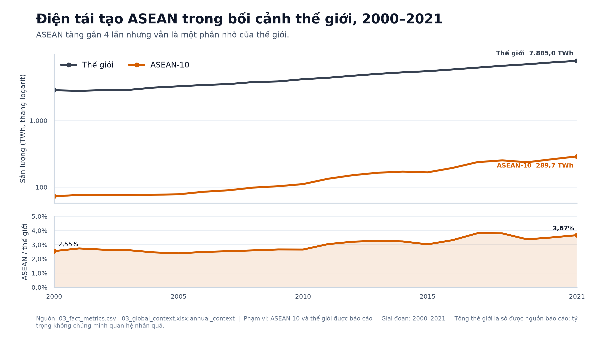

**C01 — Thông điệp:** ASEAN tăng gần bốn lần, từ 72,800904 lên
289,655745 TWh, nhưng năm 2021 vẫn chỉ bằng 3,6735% mức thế giới được báo
cáo. **Nguồn/phạm vi:** `03_fact_metrics.csv`,
`03_global_context.xlsx:annual_context`; ASEAN-10 và thế giới, 2000–2021.
**Giới hạn:** tổng thế giới là số do nguồn công bố; panel logarit chỉ chứa
giá trị dương và xu hướng không chứng minh nguyên nhân.

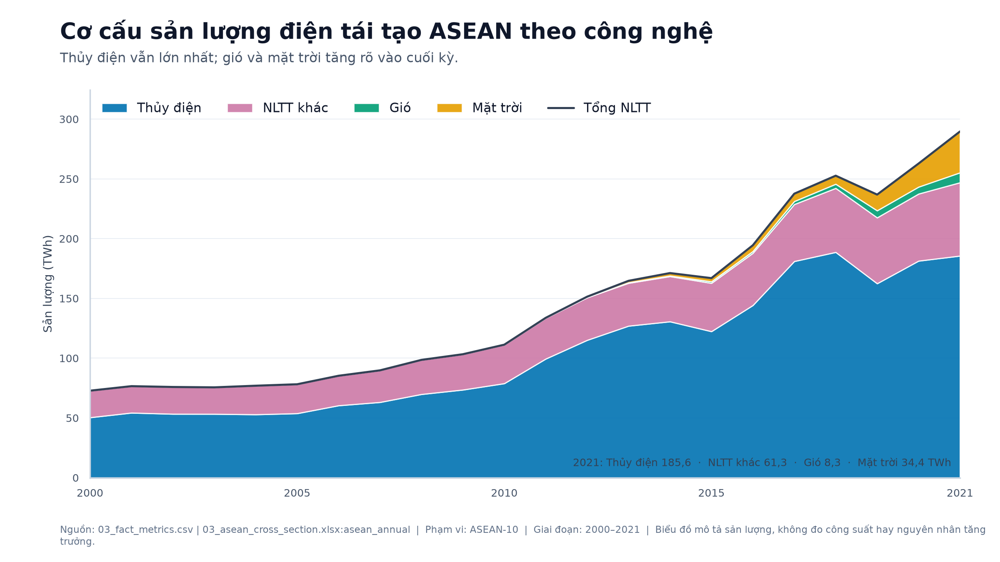

**C02 — Thông điệp:** thủy điện vẫn là thành phần lớn nhất; gió và mặt trời
tăng rõ ở cuối kỳ. **Nguồn/phạm vi:** `03_fact_metrics.csv`,
`03_asean_cross_section.xlsx:asean_annual`; ASEAN-10, 2000–2021.
**Giới hạn:** đây là sản lượng điện, không phải công suất; tổng từng năm chỉ
được vẽ sau khi bốn thành phần khớp tổng NLTT.

## Nhóm 2 — So sánh trong ASEAN

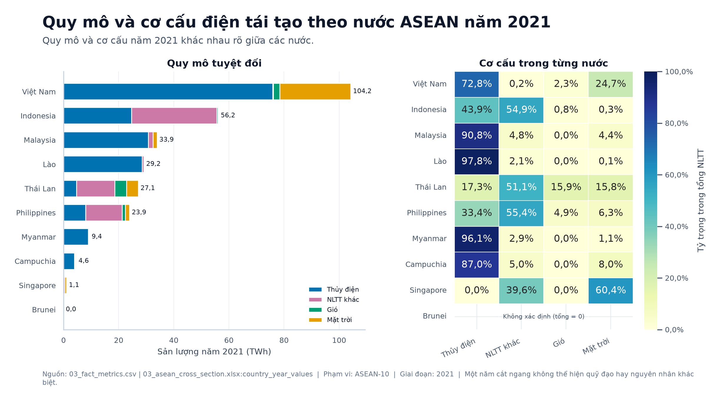

**C03 — Thông điệp:** quy mô và cơ cấu năm 2021 khác nhau rõ giữa các nước.
**Nguồn/phạm vi:** `03_fact_metrics.csv`,
`03_asean_cross_section.xlsx:country_year_values`; ASEAN-10, năm 2021.
**Giới hạn:** lát cắt một năm không cho biết nguyên nhân; tỷ trọng của Brunei
để không xác định vì tổng bằng 0, không bị thay bằng bốn giá trị 0 giả. Nhãn
tỷ trọng dùng một chữ số thập phân và không làm tròn giá trị dương thành 0%.

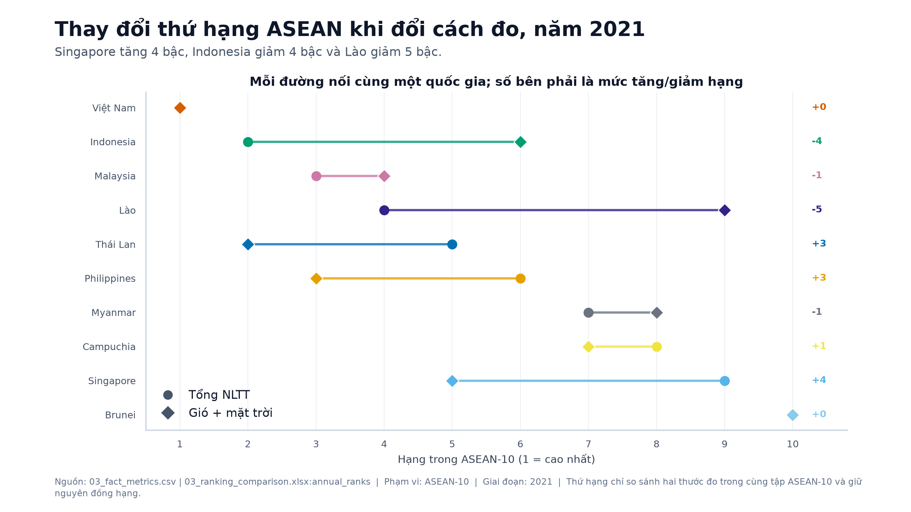

**C04 — Thông điệp:** khi chuyển từ tổng NLTT sang gió + mặt trời,
Singapore tăng 4 bậc, Indonesia giảm 4 bậc và Lào giảm 5 bậc.
**Nguồn/phạm vi:** `03_fact_metrics.csv`,
`03_ranking_comparison.xlsx:annual_ranks`; ASEAN-10, năm 2021.
**Giới hạn:** hạng 1 ở phía trên, đồng hạng được giữ nguyên và màu biểu thị
quốc gia chứ không biểu thị thứ hạng.

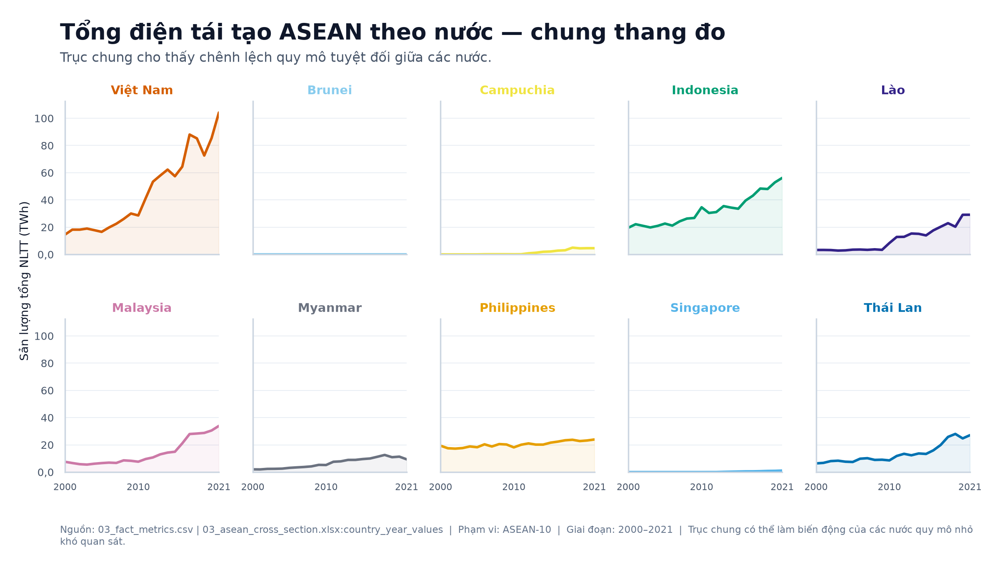

**C05 — Thông điệp:** thang đo chung làm rõ chênh lệch quy mô tuyệt đối giữa
10 nước. **Nguồn/phạm vi:** `03_fact_metrics.csv`,
`03_asean_cross_section.xlsx:country_year_values`; ASEAN-10, 2000–2021.
**Giới hạn:** biến động của nước có quy mô nhỏ có thể khó quan sát trên trục
chung.

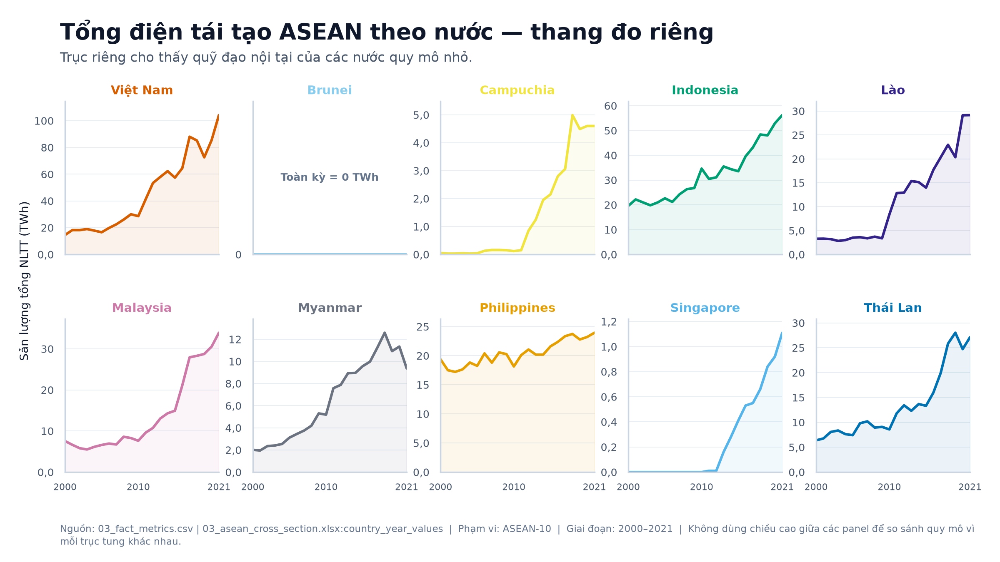

**C06 — Thông điệp:** thang đo riêng cho thấy quỹ đạo nội tại của các nước
quy mô nhỏ. **Nguồn/phạm vi:** cùng đúng 220 quan sát và cùng thứ tự với C05.
**Giới hạn:** không so sánh chiều cao giữa các panel vì mỗi trục tung có giới
hạn khác nhau.

## Nhóm 3 — Việt Nam

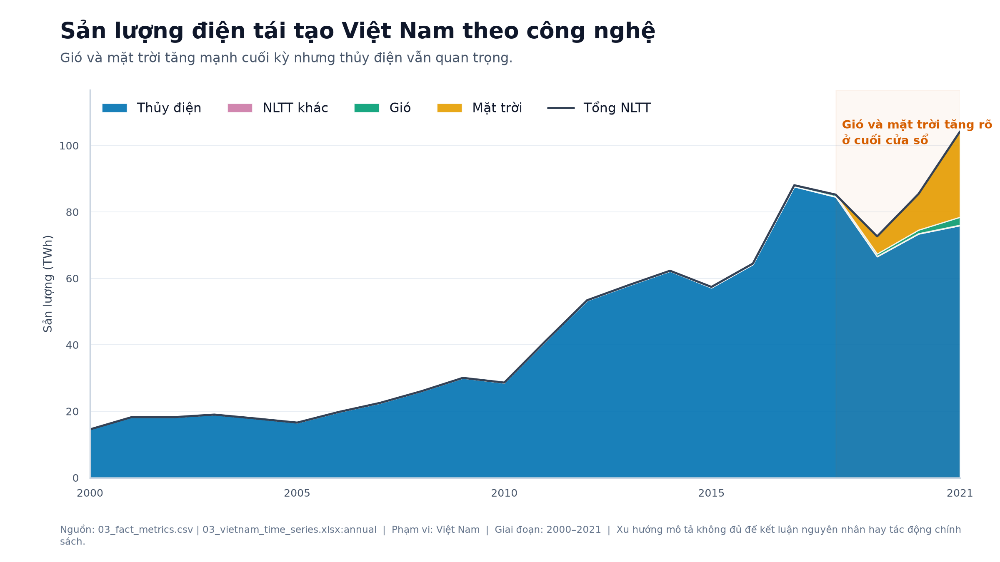

**C07 — Thông điệp:** gió và mặt trời tăng mạnh cuối cửa sổ, nhưng thủy điện
vẫn quan trọng. **Nguồn/phạm vi:** `03_fact_metrics.csv`,
`03_vietnam_time_series.xlsx:annual`; Việt Nam, 2000–2021.
**Giới hạn:** biểu đồ mô tả xu hướng, không xác lập nguyên nhân hay tác động
chính sách.

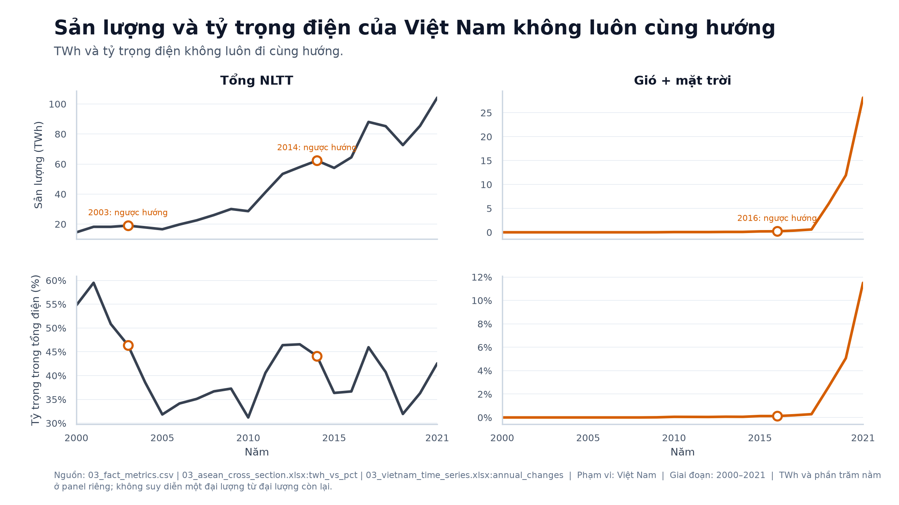

**C08 — Thông điệp:** TWh và tỷ trọng trong tổng điện không luôn cùng hướng;
các năm ngược hướng là 2003, 2014 đối với tổng NLTT và 2016 đối với gió +
mặt trời. **Nguồn/phạm vi:** `03_fact_metrics.csv`, các sheet `twh_vs_pct` và
`annual_changes`; Việt Nam, 2000–2021. **Giới hạn:** hai đơn vị nằm ở panel
riêng, không dùng trục kép và không suy diễn nguyên nhân.

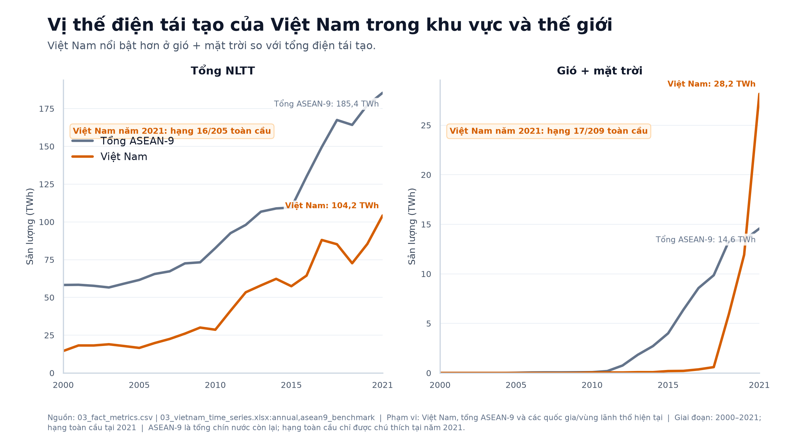

**C09 — Thông điệp:** Việt Nam nổi bật hơn ở gió + mặt trời so với tổng
NLTT. Năm 2021, cặp Việt Nam/tổng ASEAN-9 lần lượt là
104,218036/185,437709 TWh và 28,16/14,57 TWh. **Nguồn/phạm vi:**
`03_fact_metrics.csv`, `03_vietnam_time_series.xlsx:annual,asean9_benchmark`;
Việt Nam và tổng chín nước ASEAN còn lại, 2000–2021. **Giới hạn:** ASEAN-9
là tổng, không phải trung bình; hạng 16/205 và 17/209 chỉ được chú thích tại
năm 2021.

## Nhóm 4 — Phân phối và chẩn đoán

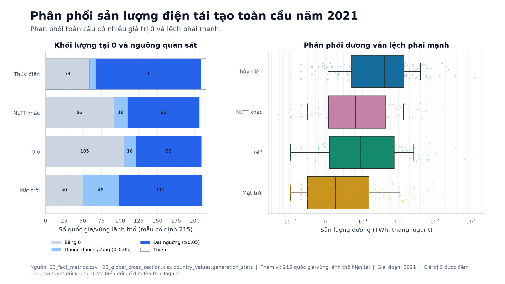

**C10 — Thông điệp:** phân phối toàn cầu có nhiều giá trị 0 và lệch phải
mạnh. **Nguồn/phạm vi:** `03_fact_metrics.csv`,
`03_global_cross_section.xlsx:country_values,generation_stats`; mẫu cố định
215 quốc gia/vùng lãnh thổ, năm 2021. **Giới hạn:** 0 được đếm riêng; chỉ giá
trị dương đi vào panel logarit, không cộng số giả.

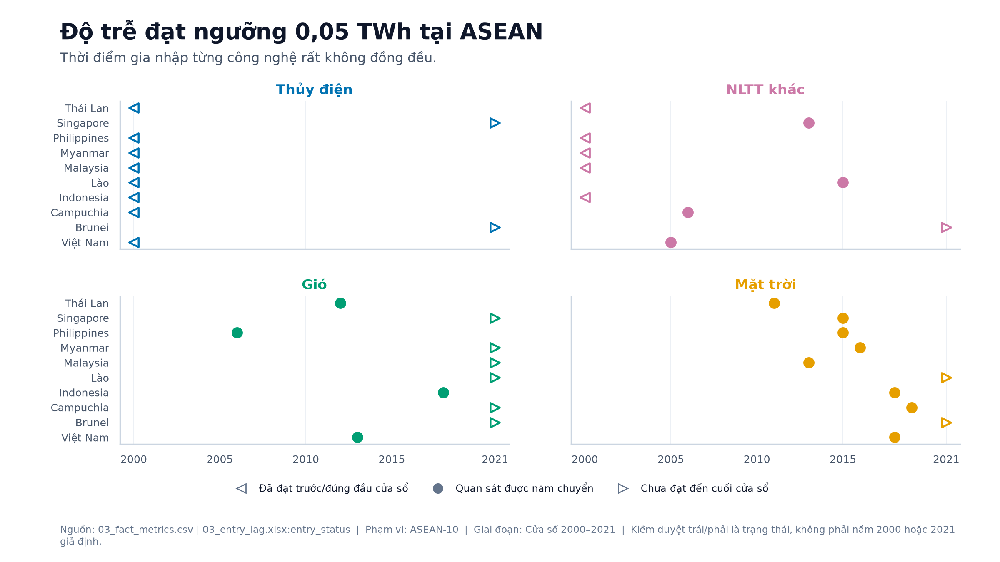

**C11 — Thông điệp:** thời điểm đạt ngưỡng của từng công nghệ rất không đồng
đều. **Nguồn/phạm vi:** `03_fact_metrics.csv`,
`03_entry_lag.xlsx:entry_status`; ASEAN-10, cửa sổ 2000–2021.
**Giới hạn:** ký hiệu tam giác là trạng thái kiểm duyệt trái/phải, không phải
năm 2000 hoặc 2021 được gán thay.

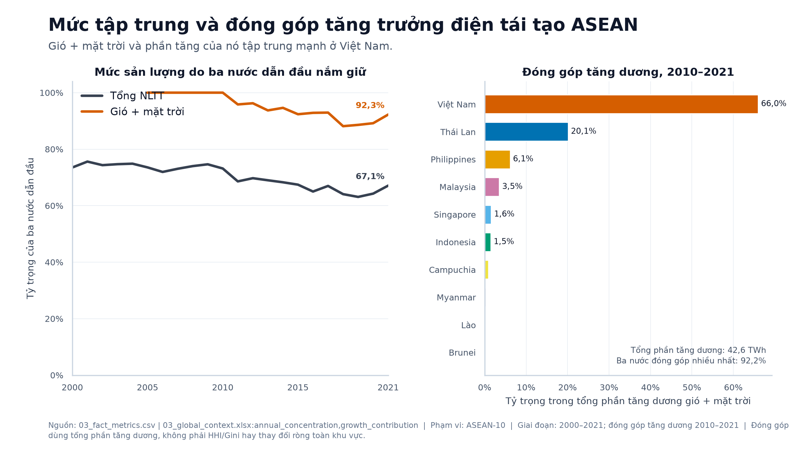

**C12 — Thông điệp:** năm 2021, ba nước dẫn đầu nắm 92,2537% gió + mặt trời
so với 67,1023% tổng NLTT; Việt Nam đóng góp 65,9859% tổng phần tăng dương
gió + mặt trời giai đoạn 2010–2021. **Nguồn/phạm vi:**
`03_fact_metrics.csv`, các sheet `annual_concentration` và
`growth_contribution`; ASEAN-10. **Giới hạn:** tỷ trọng đóng góp dùng tổng
phần tăng dương, không phải thay đổi ròng, HHI hay Gini của mức sản lượng.

## Nhóm 5 — Chỉ số phụ có độ phủ hạn chế

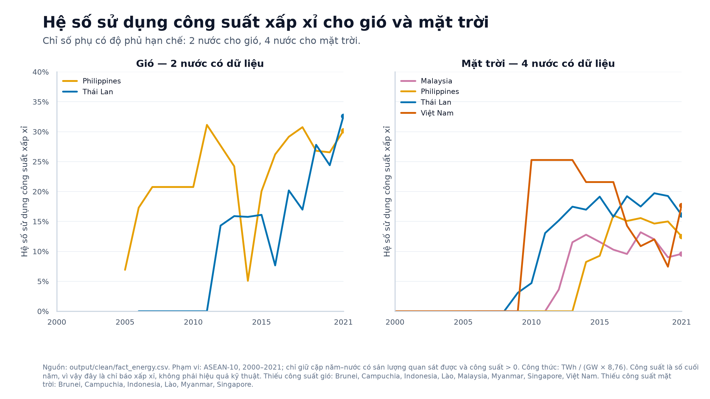

**C13 — Thông điệp:** chỉ có 33 quan sát gió của Philippines và Thái Lan,
cùng 71 quan sát mặt trời của Malaysia, Philippines, Thái Lan và Việt Nam.
**Nguồn/phạm vi:** `output/clean/fact_energy.csv` được khóa bằng 89.075 dòng,
mã SHA-256 và dấu vân tay Phase 2 tính lại từ SQLite; ASEAN-10, 2000–2021 theo
cặp năm–nước khả dụng. **Giới hạn:** chỉ số được tính bằng
`TWh / (GW × 8,76)` với công suất cuối năm, nên chỉ là chỉ báo xấp xỉ và
không phải thước đo hiệu quả kỹ thuật; danh sách nước thiếu được ghi trực
tiếp trên hình.

# 1.5. Diễn giải và trình bày kết quả

## 1.5a. Phân tích kết quả và kết luận có ý nghĩa

Năm phát hiện dưới đây được chọn từ 34 mục đã ghi trong `docs/NhatKyPhanTich.md`,
theo bốn tiêu chí đặt trước khi chọn: trả lời trực tiếp câu hỏi trung tâm · có con
số truy được về `output/stats/` · có ít nhất một biểu đồ đã nghiệm thu · không trùng
thông điệp với phát hiện khác.

**Mọi con số trong mục này đã được tính lại từ nguồn, không chép lại từ nhật ký.**
`python/06_verify_findings.py` thu ba cách đọc độc lập cho từng con số — hằng số
chép tay trong `python/phase6_contract.py`, tra cứu trong `03_fact_metrics.csv`, và
một phép tính lại chỉ đọc `output/clean/*.csv` — rồi từ chối công bố nếu bất kỳ cặp
nào lệch. Kết quả: **47/47 khớp**, chênh lệch lớn nhất `9,1 × 10⁻¹³`, dưới dung sai
`10⁻⁹`. Bảng chứng cứ đầy đủ ở `output/stats/06_finding_evidence.csv`, mỗi dòng kèm
khoá dòng cụ thể của nguồn.

---

### Phát hiện 1 — Quy mô tăng gần bốn lần, nhưng chỗ đứng trên thế giới gần như không đổi

Sản lượng năng lượng tái tạo của ASEAN-10 đi từ **72,801 TWh** năm 2000 lên
**289,656 TWh** năm 2021 — gấp **3,98 lần**. Đọc riêng con số này thì đó là một câu
chuyện tăng trưởng mạnh.

Nhưng thế giới cũng tăng trong cùng giai đoạn, từ **2.854,49** lên **7.885,04 TWh**.
Kết quả là tỷ trọng của ASEAN chỉ nhích từ **2,5504%** lên **3,6735%** — thêm khoảng
**1,1 điểm phần trăm** sau 21 năm.

**Diễn giải.** Khu vực chạy nhanh, nhưng chạy trong một đoàn đang cùng tăng tốc. Mọi
phát biểu kiểu "ASEAN đang bứt lên trong chuyển dịch năng lượng toàn cầu" cần được
kèm ngay mẫu số này, nếu không nó đúng về lượng mà sai về vị thế. Đây cũng là lý do
báo cáo dùng cả hai thước đo — sản lượng tuyệt đối và tỷ trọng — ở mọi chỗ có thể.

*Truy vết:* `F1_ASEAN_2000`, `F1_ASEAN_2021`, `F1_WORLD_2000`, `F1_WORLD_2021`,
`F1_SHARE_2000`, `F1_SHARE_2021`.

---

### Phát hiện 2 — Gió và mặt trời đi lên từ mức đúng bằng không, nhưng thuỷ điện vẫn là nguồn lớn nhất

Năm 2000, tổng sản lượng gió cộng mặt trời của cả mười nước ASEAN là **0 TWh** —
không phải "rất nhỏ", mà đúng bằng không. Năm 2010 mới đạt **0,13 TWh**. Đến 2021 là
**42,73 TWh**.

Chính vì nền xuất phát bằng 0 mà **tốc độ tăng của nhóm này không tính được** cho
giai đoạn 2000–2021: mọi công thức tăng trưởng đều cần mẫu số dương. Đây không phải
lỗi dữ liệu mà là một tính chất của hiện tượng, và báo cáo ghi `NOT_DEFINED` thay vì
điền một con số cho đẹp bảng.

Cơ cấu năm 2021 cho thấy phần còn lại của bức tranh:

| Công nghệ | TWh | Tỷ trọng |
|---|---:|---:|
| Thuỷ điện | 185,58 | 64,07% |
| Nguồn tái tạo khác | 61,3457 | 21,18% |
| Mặt trời | 34,43 | 11,89% |
| Gió | 8,30 | 2,87% |

**Diễn giải.** Gió và mặt trời cộng lại mới chiếm **14,75%** sản lượng tái tạo của
khu vực. Câu chuyện "bùng nổ điện mặt trời Đông Nam Á" là có thật về tốc độ nhưng
chưa đúng về quy mô: cấu trúc nguồn của ASEAN năm 2021 vẫn là cấu trúc thuỷ điện.
Hai câu này chỉ mâu thuẫn khi người ta bỏ mất một trong hai thước đo.

*Truy vết:* `F2_MODERN_2000`, `F2_MODERN_2010`, `F2_MODERN_2021`, `F2_HYDRO_2021`,
`F2_OTHER_2021`, `F2_SOLAR_2021`, `F2_WIND_2021`.

---

### Phát hiện 3 — Đổi định nghĩa "năng lượng tái tạo" là đổi luôn bảng xếp hạng khu vực

Cùng một năm 2021, cùng mười nước, chỉ đổi thước đo từ **tổng năng lượng tái tạo**
sang **gió + mặt trời**, thứ hạng đảo lại:

| Nước | Hạng theo tổng NLTT | Hạng theo gió + mặt trời | Thay đổi |
|---|---:|---:|---:|
| Việt Nam | 1 | 1 | 0 |
| Indonesia | 2 | 6 | **−4** |
| Lào | 4 | 9 | **−5** |
| Thái Lan | 5 | 2 | **+3** |
| Philippines | 6 | 3 | **+3** |
| Singapore | 9 | 5 | **+4** |

**Diễn giải.** Indonesia và Lào tụt vì thế mạnh của họ là thuỷ điện và địa nhiệt —
những nguồn tái tạo lâu đời, phụ thuộc địa hình. Singapore vọt lên 4 bậc dù sản lượng
tuyệt đối rất nhỏ, vì gần như toàn bộ phần tái tạo của họ là điện mặt trời.

Việt Nam giữ hạng 1 ở **cả hai** cách đo, và đó là điều đáng chú ý nhất trong bảng:
nó cho thấy sự đảo lộn không phải do cả bảng cùng xê dịch.

Hệ quả về phương pháp: **một bảng xếp hạng năng lượng tái tạo không có nghĩa nếu
không nói rõ nó đang đo cái gì.** Đây chính là lý do dashboard Phase 5 đặt công tắc
chuyển giữa hai thước đo ngay trên hàng bộ lọc chứ không giấu trong một trang phụ.

*Truy vết:* 18 claim `F3_RANK_*` và `F3_GAIN_*`.

---

### Phát hiện 4 — Việt Nam nắm hai phần ba lượng gió và mặt trời của ASEAN, và hai phần ba phần tăng thêm

Năm 2021 Việt Nam sản xuất **104,2180 TWh** năng lượng tái tạo, chiếm **35,9800%**
toàn khu vực và đứng **hạng 16 thế giới**.

Riêng gió và mặt trời, mức tập trung còn cao hơn nhiều: **28,16 TWh**, bằng
**65,9022%** của cả ASEAN, **hạng 17 thế giới**.

Nhìn theo phần tăng thêm giai đoạn 2010–2021 thì bức tranh rõ hơn nữa. Trong tổng
mức tăng dương của cả khu vực, Việt Nam đóng góp **42,3781%** ở tổng năng lượng tái
tạo và **65,9859%** ở riêng gió + mặt trời.

**Diễn giải.** Gần như toàn bộ tăng trưởng gió và mặt trời của Đông Nam Á trong hơn
một thập kỷ đến từ một nước. Điều này khiến chỉ số trung bình của khu vực trở nên
gây hiểu lầm: "ASEAN tăng trưởng điện mặt trời" thực chất mô tả Việt Nam cộng với
chín nước tăng chậm hơn nhiều.

⚠️ Bộ dữ liệu này **không** cho biết vì sao. Không có biến chính sách, giá thành hay
cơ chế khuyến khích trong 17 file nguồn, nên mọi giải thích nguyên nhân — kể cả những
giải thích nghe rất hợp lý — đều nằm ngoài phạm vi chứng minh được ở đây.

*Truy vết:* `F4_VN_TOTAL_2021`, `F4_VN_MODERN_2021`, `F4_VN_SHARE_TOTAL`,
`F4_VN_SHARE_MODERN`, `F4_VN_GLOBAL_RANK_TOTAL`, `F4_VN_GLOBAL_RANK_MODERN`,
`F4_VN_GROWTH_TOTAL`, `F4_VN_GROWTH_MODERN`.

---

### Phát hiện 5 — Đà tăng của khu vực tập trung vào rất ít nước

Ba chỉ số tập trung, đo trên cùng mười nước năm 2021, đều cho cùng một kết luận và
đều cao hơn hẳn khi chuyển sang thước đo hiện đại:

| Chỉ số | Tổng NLTT | Gió + mặt trời |
|---|---:|---:|
| Tỷ trọng ba nước dẫn đầu | 67,1023% | **92,2537%** |
| HHI | 0,207886 | **0,480404** |
| Gini | 0,529218 | **0,771285** |

**Diễn giải.** Ba nước giữ hơn **92%** lượng gió và mặt trời của cả khối. HHI vượt
0,48 — mức mà trong phân tích cạnh tranh được coi là tập trung rất cao. Ba chỉ số này
đo ba thứ khác nhau (tỷ trọng nhóm dẫn đầu, độ phân tán bình phương, độ bất bình
đẳng) nên việc cả ba cùng chỉ một hướng làm kết luận vững hơn một chỉ số đơn lẻ.

Hệ quả trực tiếp: **một con số trung bình cho ASEAN sẽ che mất bức tranh thật.** Mọi
biểu đồ ở mục 1.4 vì thế đều tách theo nước thay vì gộp khu vực, và dashboard giữ
mẫu số khu vực cố định `ASEAN_SUM_10` khi người xem lọc theo một nước.

*Truy vết:* `F5_TOP1_*`, `F5_TOP3_*`, `F5_HHI_*`, `F5_GINI_*`.

---

### Mạch nối năm phát hiện

Năm phát hiện không rời rạc mà thu hẹp dần theo đúng câu hỏi trung tâm:

> Khu vực tăng mạnh nhưng chưa đổi vị thế **(1)** · phần tăng ấy chủ yếu vẫn là thuỷ
> điện, còn gió và mặt trời mới xuất phát **(2)** · nên trả lời "ai dẫn đầu" phụ
> thuộc vào việc đo cái gì **(3)** · đo theo nguồn hiện đại thì gần như chỉ có một
> nước **(4)** · và mức tập trung ấy cao đến độ trung bình khu vực mất ý nghĩa **(5)**.

## 1.5b. Slide trình bày

**Sản phẩm:** `output/slides/ASEAN_Renewables.pptx` — 11 slide, khổ 16:9, sinh bằng
`python/06_build_slides.py`.

Slide được **dựng bằng script** thay vì làm tay, cùng một nếp với 13 biểu đồ của
Phase 4 và dự án Power BI của Phase 5. Lý do không phải tiện lợi mà là kiểm chứng:
tiêu chí "mỗi con số trên slide truy được về một bảng trong `output/stats/`" nếu làm
tay thì phải soi bằng mắt, còn sinh bằng script thì mọi con số đọc thẳng từ
`python/phase6_contract.py` — tức từ chính tập 47 số đã qua kiểm chứng ba chiều.

Ràng buộc này được **cưỡng chế** chứ không chỉ tuyên bố: hàm `assert_no_stray_numbers()`
quét toàn bộ chữ trên 11 slide, đối chiếu từng chuỗi số với tập giá trị sinh ra từ
hợp đồng, và **từ chối ghi file** nếu còn một con số không truy được nguồn.

**Mạch 11 slide:**

| # | Nội dung | Hình |
|---|---|---|
| 1 | Móc mở đầu — một câu hỏi, một con số | |
| 2 | Câu hỏi trung tâm và sáu câu hỏi con | |
| 3 | Dữ liệu **không** trả lời được những gì | C13 |
| 4 | Bốn khuyết điểm tìm thấy trong 17 file gốc | |
| 5 | Làm sạch, và cách chứng minh đã làm đúng | |
| 6 | Phát hiện 1 — quy mô tăng, vị thế không đổi | C01 |
| 7 | Phát hiện 2 — gió và mặt trời xuất phát từ 0 | C02 |
| 8 | Phát hiện 3 — đổi cách đo là đổi thứ hạng | C04 |
| 9 | Phát hiện 4 — hai phần ba nằm ở một nước | C07 |
| 10 | Phát hiện 5 — đà tăng tập trung vào rất ít nước | C12 |
| 11 | Hướng đi tiếp và dữ liệu còn thiếu | |

Mạch đi theo **lập luận**, không theo trình tự công việc: câu hỏi → giới hạn dữ liệu
→ khuyết điểm dữ liệu → cách chứng minh đã xử lý đúng → năm phát hiện → hướng tiếp.
Không slide nào nói "tôi đã dùng pandas" hay "tôi đã viết SQL", vì đó là thứ tự làm
việc chứ không phải mạch lý lẽ.

Cặp slide **4 + 5** là chỗ đặt trọng tâm: nêu bốn khuyết điểm cụ thể của dữ liệu gốc,
rồi cho thấy chúng đã được xử lý và **chứng minh** là xử lý đúng. Slide 11 cố ý chỉ
mở hướng — kết luận và đề xuất đầy đủ thuộc mục 1.6.

**Quy ước trình bày:** bảng màu và cách viết số lấy nguyên của Phase 4 — `1.000` cho
hàng nghìn, `0,0` cho thập phân, màu nhấn `#D55E00` cho Việt Nam. Dựng hai lần cho
tệp **giống hệt từng byte** (`44568cb7…`); dấu thời gian trong ZIP được chuẩn hoá để
mã băm phản ánh nội dung chứ không phản ánh giờ chạy.

## 1.5c. Dashboard

Dashboard được dựng bằng Power BI Desktop trên mô hình sao đọc thẳng bảy tệp
`output/clean/*.csv` của Phase 2 — **không** nối vào `sql/renewables.db`, vì Power BI
không có connector SQLite native và trình điều khiển ODBC cần quyền quản trị mà máy
thực hiện không có. Đây là lựa chọn có chủ ý, không phải hạn chế phát sinh.

**Mô hình.** Tám bảng: bốn bảng vận hành (`FactEnergy` 89.075 dòng, `DimEntity` 256,
`DimMetric` 16, `DimYear` 57) và ba bảng chọn không quan hệ (`SelReportYear`,
`SelMode`, `SelBaseYear`) đóng vai bộ điều khiển cho các phép đo. Ba quan hệ một–nhiều
từ ba bảng chiều sang bảng dữ kiện.

**Phép đo.** 73 phép đo DAX sinh từ **một** nguồn duy nhất là `python/05_measures.py`,
xuất song song ra TMDL và ra danh mục `powerbi/DAX_Measures.md`. Mỗi phép đo có mã
`M###` và định nghĩa nghiệp vụ viết ra được — đây là điều kiện mà mục 1.5c đặt ra
ngay từ đầu: KPI định nghĩa mơ hồ là chỗ dashboard mất tín nhiệm.

**Ba trang, 47 ô trực quan.** Trang 1 tổng quan Đông Nam Á (14 ô), trang 2 Việt Nam
chuyên sâu (15 ô), trang 3 so sánh và chẩn đoán (18 ô). Mỗi trang có cùng một hàng
bộ lọc ở vị trí cố định — năm báo cáo, chế độ đo, quốc gia, công nghệ — và một chân
trang ghi nguồn, cửa sổ năm, lý do loại năm 2022 và ghi chú đã loại thực thể tổng hợp.

**Công tắc "chỉ NLTT hiện đại"** là trục phân tích của dashboard chứ không phải một
tuỳ chọn trang trí: bật nó lên ở năm 2021 thì thứ hạng ASEAN đảo lại — Singapore
tăng 4 bậc, Indonesia giảm 4, Lào giảm 5 — và đó chính là phát hiện P3-06.

**Kiểm định.** 169 truy vấn nghiệm thu DAX sinh tự động từ bộ đích của Phase 3, cộng
6 mã khoá đường cơ sở: **175/175 đạt, 0 dòng chặn**. Thêm 10 tiêu chí đọc thẳng tệp
trên đĩa (C1–C10) bắt các sai lệch giữa danh mục phép đo và tệp bàn giao — bộ tiêu
chí này ra đời sau khi một sai lệch như vậy thực sự xảy ra, xem phát hiện P5-03.

**Giới hạn — phải đọc kèm.** Lớp định lượng đã được chứng minh; **lớp tương tác và
trình bày chưa nghiệm thu**. Cụ thể: bộ lọc chưa đồng bộ giữa ba trang, chưa có dấu
trang đặt lại và thanh điều hướng, chưa áp bảng màu Phase 4, ma trận tương tác để
mặc định, và giao diện còn tiếng Anh. Tệp `.pbix` tại thời điểm nộp mang bản model
cũ 71 phép đo, nên **sản phẩm hợp lệ của mục này là dự án dạng văn bản PBIP cộng
`powerbi/DAX_Measures.md`**. Chi tiết đầy đủ ở `docs/Phase5_Review.md` §5.

# 1.6. Kết luận và đề xuất

Mỗi kết luận dưới đây neo vào một con số đã qua kiểm chứng ba chiều ở Gate E3
(`output/stats/06_finding_evidence.csv`, **56/56 khớp**). Mã trong ngoặc là
`claim_id` để tra ngược.

## 1.6.1. Năm kết luận

**Kết luận 1 — Đông Nam Á đang chuyển dịch, nhưng chưa đủ nhanh để đổi vị thế.**
Sản lượng năng lượng tái tạo của ASEAN-10 tăng từ **72,801** lên **289,656 TWh**
trong 21 năm, tức gấp **3,98 lần**. Cùng kỳ, tỷ trọng của khu vực trong tổng sản
lượng thế giới chỉ đi từ **2,5504%** lên **3,6735%** — thêm **1,12 điểm phần trăm**.
Khu vực tăng nhanh hơn nền chung, nhưng biên độ vượt lên rất mỏng.
*(`F1_ASEAN_2000`, `F1_ASEAN_2021`, `F1_SHARE_2000`, `F1_SHARE_2021`)*

**Kết luận 2 — Cơ cấu nguồn của ASEAN năm 2021 vẫn là cơ cấu thuỷ điện.**
Thuỷ điện chiếm **185,58 TWh**, tức **64,07%** tổng sản lượng tái tạo của khu vực.
Gió và mặt trời cộng lại được **42,73 TWh**, tức **14,75%**. Nhóm nguồn hiện đại
tăng rất nhanh nhưng xuất phát từ **đúng 0 TWh** năm 2000, nên tốc độ ấn tượng đang
mô tả một nền rất thấp chứ chưa mô tả một sự thay thế.
*(`F2_HYDRO_2021`, `F2_MODERN_2000`, `F2_MODERN_2021`, `F1_ASEAN_2021`)*

**Kết luận 3 — Đà chuyển dịch sang nguồn hiện đại tập trung vào rất ít nước.**
Ba nước dẫn đầu giữ **92,2537%** lượng gió và mặt trời của cả khối, so với
**67,1023%** khi đo bằng tổng năng lượng tái tạo. HHI tăng từ **0,2079** lên
**0,4804**; Gini từ **0,5292** lên **0,7713**. Ba chỉ số đo ba thứ khác nhau —
tỷ trọng nhóm dẫn đầu, độ phân tán bình phương, độ bất bình đẳng — và cùng chỉ một
hướng, nên kết luận vững hơn một chỉ số đơn lẻ.
*(`F5_TOP3_TOTAL`, `F5_TOP3_MODERN`, `F5_HHI_*`, `F5_GINI_*`)*

**Kết luận 4 — Việt Nam là nguồn tăng trưởng chính của khu vực ở nhóm nguồn hiện đại.**
Năm 2021 Việt Nam chiếm **65,9022%** lượng gió và mặt trời của ASEAN-10, và đóng góp
**65,9859%** toàn bộ mức tăng dương của khu vực giai đoạn 2010–2021. Ở tổng năng
lượng tái tạo, hai con số tương ứng là **35,9800%** và **42,3781%**. Nói cách khác,
"ASEAN tăng trưởng điện gió và mặt trời" thực chất mô tả Việt Nam cộng chín nước tăng
chậm hơn nhiều.
*(`F4_VN_SHARE_MODERN`, `F4_VN_GROWTH_MODERN`, `F4_VN_SHARE_TOTAL`, `F4_VN_GROWTH_TOTAL`)*

**Kết luận 5 — Xếp hạng khu vực phụ thuộc vào định nghĩa được chọn.**
Chỉ đổi thước đo trong cùng năm 2021, Singapore tăng **4 bậc**, Thái Lan và
Philippines mỗi nước tăng **3 bậc**, còn Indonesia giảm **4** và Lào giảm **5**. Việt
Nam giữ hạng **1** ở cả hai cách đo — chi tiết này cho thấy đây là sự đảo vị trí thật
chứ không phải cả bảng cùng xê dịch. Hệ quả: mọi bảng xếp hạng năng lượng tái tạo đều
vô nghĩa nếu không nói rõ nó đang đo cái gì.
*(18 claim `F3_RANK_*` và `F3_GAIN_*`)*

## 1.6.2. Đề xuất

Mỗi đề xuất viết theo dạng *"dữ liệu cho thấy X, nên cần xem xét Y"*. Đây là hướng
cần cân nhắc, **không** phải phương án đã tính chi phí hay đã đánh giá khả thi.

### Cho Việt Nam

| # | Dữ liệu cho thấy | Nên xem xét |
|---|---|---|
| VN-1 | Việt Nam chiếm **65,9022%** gió + mặt trời của ASEAN nhưng chỉ **35,9800%** tổng NLTT — tập trung vào một nhóm công nghệ | Đánh giá rủi ro vận hành hệ thống, vì gió và mặt trời là nguồn phát không điều độ được; cân nhắc đầu tư lưu trữ và điều độ song song với công suất mới |
| VN-2 | Tỷ trọng NLTT trong sản lượng điện **giảm** từ **54,7816%** (2000) xuống **42,5787%** (2021) — mất **12,20 điểm phần trăm** — dù sản lượng tuyệt đối tăng **7,16 lần** | Đặt chỉ tiêu theo **tỷ trọng**, không chỉ theo TWh. Sản lượng tăng bảy lần vẫn có thể đi kèm tỷ trọng giảm nếu tổng cầu điện tăng nhanh hơn |
| VN-3 | Có **2 năm** (2003, 2014) mà sản lượng và tỷ trọng đi ngược chiều nhau | Khi đặt chỉ tiêu, tách rõ hai loại mục tiêu — tăng sản lượng và tăng tỷ trọng không đồng nghĩa, và có năm chúng mâu thuẫn |
| VN-4 | Hạng **16** thế giới về tổng NLTT nhưng hạng **17** về gió + mặt trời | Nhóm nguồn hiện đại chưa tạo được lợi thế xếp hạng tương xứng với quy mô; nên so chuẩn với các nước cùng hạng toàn cầu thay vì chỉ so trong ASEAN |

### Cho khu vực ASEAN

| # | Dữ liệu cho thấy | Nên xem xét |
|---|---|---|
| KV-1 | **6/10** nước — Brunei, Campuchia, Lào, Malaysia, Myanmar, Singapore — không sản xuất một kWh điện gió nào năm 2021 | Cơ chế hợp tác và mua bán điện khu vực có thể hiệu quả hơn nỗ lực đơn lẻ ở những nước quy mô nhỏ hoặc thiếu tiềm năng gió |
| KV-2 | HHI nhóm hiện đại đạt **0,4804**, mức được coi là tập trung rất cao | Theo dõi chỉ số tập trung như một chỉ báo thường kỳ, vì mức này khiến cả khu vực nhạy cảm với biến động chính sách ở một nước duy nhất |
| KV-3 | Tỷ trọng ASEAN trong thế giới chỉ tăng **1,12 điểm phần trăm** sau 21 năm | Đặt mục tiêu khu vực theo tỷ trọng toàn cầu, không chỉ theo tăng trưởng nội khối — nội khối tăng gần 4 lần mà vị thế gần như không đổi |
| KV-4 | Thuỷ điện chiếm **64,07%** và phụ thuộc địa hình, không nhân rộng đều được | Kỳ vọng tăng trưởng tương lai nên đặt vào nhóm nguồn nhân rộng được, và đánh giá riêng cho từng nước thay vì áp một mục tiêu chung |

## 1.6.3. Những gì **không** thể đề xuất từ bộ dữ liệu này

Mục này liệt kê các đề xuất mà một báo cáo có thể bị cám dỗ đưa ra nhưng dữ liệu
không cho phép. Ghi ra để người đọc biết ranh giới, và để không ai trích dẫn báo cáo
này cho những kết luận nó không chứng minh được.

| Không thể nói | Vì thiếu |
|---|---|
| Nên ưu tiên đầu tư công nghệ nào để đạt hiệu quả kinh tế cao nhất | Không có giá thành, suất đầu tư, LCOE |
| Chính sách nào đã tạo ra tăng trưởng của Việt Nam | Không có biến chính sách, mốc thời gian cơ chế giá, mức trợ cấp |
| Chuyển dịch này giảm được bao nhiêu phát thải | Không có hệ số phát thải lưới, không có dữ liệu phát thải |
| Nước nào vận hành nhà máy hiệu quả hơn | Hệ số công suất chỉ tính được cho **104 cặp** nước–năm, dùng công suất cuối năm nên chỉ là chỉ báo xấp xỉ |
| Mức tiêu thụ trên đầu người hay cường độ năng lượng | Không có dân số, không có GDP |
| Nên đặt tua-bin gió trên bờ hay ngoài khơi | Dữ liệu chỉ có tổng sản lượng gió, không tách hai loại |
| Điều gì xảy ra sau năm 2021 | Năm 2022 bị cắt cụt ở 8 file và có 0 nước ASEAN, nên đã bị loại khỏi cửa sổ phân tích |

Đây là **điểm mạnh của báo cáo, không phải điểm yếu**: biết ranh giới của dữ liệu là
điều kiện để những kết luận nằm trong ranh giới ấy đáng tin.

## 1.6.4. Dữ liệu cần bổ sung cho bước tiếp theo

| Bảng cần ghép thêm | Khoá ghép | Mở ra câu hỏi hiện chưa trả lời được |
|---|---|---|
| LCOE và suất đầu tư theo công nghệ | `(technology, year)` | Ưu tiên công nghệ nào cho mỗi đồng vốn |
| Mốc thời gian chính sách và cơ chế giá từng nước | `(entity, year)` | Chính sách nào đi trước tăng trưởng, chính sách nào đi sau |
| Công suất lắp đặt đầy đủ, cả 10 nước × 4 công nghệ | `(entity, year, technology)` | Hệ số công suất cho toàn khu vực thay vì 104 cặp |
| Dân số và tổng sản lượng điện | `(entity, year)` | Chuẩn hoá theo quy mô, so sánh công bằng Singapore với Indonesia |
| Hệ số phát thải lưới | `(entity, year)` | Quy đổi chuyển dịch thành lượng phát thải tránh được |
| Sản lượng gió tách trên bờ / ngoài khơi | `(entity, year)` | Đánh giá tiềm năng gió ngoài khơi của Việt Nam và Philippines |

## 1.6.5. Ghi chú về mức tin cậy

Năm kết luận ở §1.6.1 dựa trên con số đã qua kiểm chứng ba chiều, **mức tin cậy cao**
trong phạm vi 10 nước ASEAN, cửa sổ 2000–2021, nguồn Our World in Data (Ember + BP).

Các đề xuất ở §1.6.2 có mức tin cậy **thấp hơn** kết luận, vì chúng bắc cầu từ mô tả
sang hành động — và bước bắc cầu ấy cần dữ liệu ở §1.6.4 mới kiểm chứng được. Đó là
lý do mọi đề xuất được viết dưới dạng *"nên xem xét"* chứ không phải *"nên làm"*.

---

## Phụ lục — truy vết số liệu

| Nguồn | Nội dung |
|---|---|
| `output/stats/00_phase1_summary.txt` | Báo cáo khảo sát dữ liệu, bảy phần |
| `output/stats/01_overlap_conflict_details.csv` | Chi tiết chênh lệch giữa các nguồn |
| `output/stats/03_asean_coverage_details.csv` | Độ phủ 10 nước ASEAN × 17 file |
| `output/stats/05_last_year_check.csv` | Kiểm tra năm cuối từng file |
| `output/clean/*.csv` | Bảy bảng sạch của mô hình star/tidy-long Phase 2 |
| `output/stats/02_validation_results.csv` | 864 kết quả structural và V1–V8 |
| `sql/renewables.db` | SQLite sạch gồm dimensions, fact, audit và `vw_wide` |
| `python/02_clean_build.py` | Quy tắc chọn nguồn, làm sạch và dựng mô hình |
| `sql/01_schema.sql`, `sql/02_validate.sql` | Schema `STRICT` và logic kiểm định Phase 2 |
| `python/03_descriptive.py`, `sql/03_analysis.sql` | Hai nhánh tính Phase 3 và đối chiếu độc lập |
| `output/stats/03_fact_metrics.csv` | Giao diện chỉ số chuẩn cho các phase sau |
| `output/stats/03_validation_results.csv` | Các gate Phase 3; không có dòng FAIL |
| `docs/Phase1_KhaoSatDuLieu.md` | Giải thích phương pháp và giới hạn diễn giải |
| `docs/NhatKyPhanTich.md` | Nhật ký phát hiện, có mức tin cậy từng mục |
| `output/stats/04_chart_data.xlsx` | 16 sheet dữ liệu đứng sau 13 biểu đồ Phase 4 |
| `output/stats/03_global_context.xlsx` | Bối cảnh toàn cầu, tăng trưởng theo giai đoạn, tập trung theo năm |
| `output/stats/03_ranking_comparison.xlsx` | Xếp hạng theo năm ở cả hai thước đo |
| `output/stats/03_vietnam_time_series.xlsx` | Chuỗi Việt Nam, biến động, TWh so với tỷ trọng điện |
| `python/phase6_contract.py` | 47 con số được phép lên báo cáo và slide, kèm quan hệ tự kiểm |
| `output/stats/06_finding_evidence.csv` | Chứng cứ ba chiều cho từng con số của mục 1.5a và 1.5b |
| `python/06_verify_findings.py` | Bộ kiểm chứng Gate E3; `output/slides/ASEAN_Renewables.pptx` là sản phẩm 1.5b |
